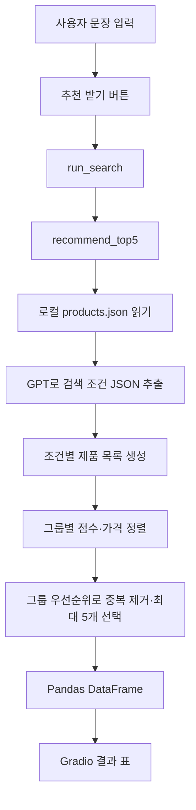

# 피부 유형·성분 기반 화장품 추천 시스템 기술문서

작성일: 2026-10-24  
기준: 작성 시점의 프로젝트 소스와 로컬 데이터  
목적: 학습한 AI 기술이 프로젝트에서 실제로 어떻게 동작하는지 설명하고, 구현 범위와 현재 제약을 기록한다.

## 1. 시스템 개요

사용자가 “나는 건성 피부야 히알루론산이 들어간 크림 추천해줘”처럼 문장을 입력하면, 프로그램이 피부 유형·제품 종류·성분을 검색 조건으로 바꾸고 제품 목록에서 최대 5개를 선정한다.

현재 Gradio 화면의 추천은 다음 역할 분담으로 이루어진다.

- **언어모델:** 사용자 문장을 읽고 검색 조건을 JSON으로 추출한다.
- **Python 코드:** 저장된 제품 목록에서 조건을 비교하고, 점수와 가격으로 정렬한다.
- **Gradio:** 사용자의 입력을 받고 결과를 표로 표시한다.

따라서 화면에서 사용하는 방식에서 GPT는 제품을 직접 만들어 추천하지 않는다. 반환할 제품은 Python 코드가 로컬 제품 목록에서 선택한다. 피부 적합성은 데이터에 기록된 라벨을 비교하는 것으로, 사용자의 피부를 진단하거나 제품의 효과를 측정하는 기능은 없다.

프로젝트에는 이 화면 외에도 벡터 검색, OpenAI 파일 검색, 네이버 쇼핑 API를 사용하는 별도 실행 경로가 있다. 각 파일이 독립적으로 동작하며, 모든 기술이 하나의 화면에 연결된 상태는 아니다.

## 2. 실행 경로 구분

| 경로 | 진입 파일 | 문장 해석 | 제품 검색·선정 | Gradio 추천 화면과의 관계 |
| --- | --- | --- | --- | --- |
| A. 화면의 추천 기능 | `src/app_gradio.py` | `main_rule_search.py`에서 GPT 호출 | 로컬 JSON 필터링·점수 계산 | 현재 연결된 방식 |
| B. 로컬 벡터 검색 | `src/main.py` | 사전·정규표현식 | SentenceTransformer + FAISS + 조건 필터 | 별도 명령행 실행 |
| C. OpenAI 파일 검색 | `src/main_openai_b.py` | GPT | 업로드한 제품 파일을 `file_search`로 검색하고 GPT가 결과 생성 | 별도 명령행 실행 |
| D. 네이버 쇼핑 연동 | `test.py` | GPT 함수호출 | 네이버 쇼핑 검색 API | 독립적인 Gradio 화면 |
| E. 규칙 기반 모듈 | `src/search_parser.py`, `src/recommender.py` | 키워드·문맥 힌트 | 규칙별 가중치 합산 | A·B에서 사용하지 않는 별도 모듈 |

파일명에 `rule_search`가 포함되어 있어도 A의 문장 해석에는 GPT API가 사용된다. 반대로 B의 검색 과정에는 생성형 언어모델 호출이 없다.

## 3. 제품 데이터 구조

제품 정보는 `data/products/products.json`에 JSON 배열로 저장되어 있다. 확인 시점에 **103개 레코드, 중복 없는 103개 ID**가 있다.

실제 첫 번째 레코드:

```json
{
  "id": "P001",
  "name": "판테놀 장벽 크림",
  "category": "cream",
  "price_krw": 28000,
  "skin_type": ["dry"],
  "ingredients_raw": "정제수, 글리세린, 판테놀, 시어버터"
}
```

| 필드 | 용도 |
| --- | --- |
| `id` | 제품 식별, 중복 제거, 벡터 검색 결과와 제품 연결 |
| `name` | 화면에 표시할 제품 이름 |
| `category` | 제품 종류 필터링 |
| `price_krw` | 가격 표시와 동점 정렬 |
| `skin_type` | 피부 유형 조건과 비교하는 문자열 목록 |
| `ingredients_raw` | 성분 문자열 포함 여부 비교와 벡터 검색용 텍스트 구성 |

현재 제품 종류는 `cleanser`, `cream`, `serum`, `sunscreen`, `toner`다. 피부 유형 데이터에는 `all`, `combination`, `dry`, `oily`, `sensitive`가 있다. 다만 코드에는 `all`을 모든 피부 유형에 자동으로 대응시키는 처리가 없다.

데이터의 원래 수집 출처, 실제 판매 여부, 가격 갱신 시점은 소스와 해당 JSON만으로 확인되지 않는다. 현재 구현에서 로컬 목록의 가격은 실시간 가격이 아니다.

## 4. A 경로: Gradio 화면에서 실제로 처리되는 과정



### 4.1 입력 수신

`src/app_gradio.py`의 버튼은 `run_search(query)`를 실행한다. 공백만 입력하면 빈 표를 반환한다. 입력이 있으면 `main_rule_search.recommend_top5(query)`를 호출한다.

### 4.2 제품 목록 읽기

`recommend_top5()`는 먼저 `load_products()`로 JSON 파일을 읽는다. 파일 위치는 실행 파일의 경로에서 프로젝트 루트를 구해 결정한다. 제품 파일이 없으면 `FileNotFoundError`가 발생한다. 제품 목록은 추천 요청마다 다시 읽는다.

### 4.3 GPT로 검색 조건 추출

`parse_query_with_llm()`은 OpenAI Responses API를 호출한다. 코드에 지정된 모델명은 `gpt-4o-mini`다. 시스템 프롬프트에는 출력 형식, 피부 유형·제품 종류 매핑, 불명확한 값은 `null`로 두라는 지시가 들어 있다.

예를 들어 다음 입력에 대해:

```text
나는 건성 피부야 히알루론산이 들어간 크림 추천해줘
```

의도하는 추출 결과는 다음과 같다.

```json
{
  "skin_type": "dry",
  "category": "cream",
  "ingredient": "히알루론산"
}
```

이 JSON은 프롬프트가 요구하는 예시이며, 이번 문서 작성 중 실제 API 응답으로 확인한 값은 아니다. 실제 추출 결과는 모델 응답에 따라 달라질 수 있다.

이 단계에서 모델로 전송되는 것은 시스템 프롬프트와 사용자 문장이다. 로컬 제품 목록 전체를 함께 보내지 않는다. 함수호출 도구나 FAISS도 사용하지 않는다.

응답 문자열을 `json.loads()`로 해석하고 세 필드만 가져온다. JSON 해석이나 필드 추출이 실패하면 세 조건을 모두 `None`으로 바꾼다. API 요청 자체는 이 예외 처리 밖에 있어 인증·네트워크 등의 요청 오류는 이 방식으로 복구되지 않는다. JSON Schema를 이용한 출력 형식 강제나 필드 타입 검증도 없다.

### 4.4 조건 비교와 단계별 완화

피부 유형은 소문자 영문값으로 정규화한다. 예를 들어 `건성`은 `dry`로 변환한다. 제품 종류는 `category`의 값과 비교하고, 성분은 `ingredients_raw`에 입력 성분 문자열이 포함되어 있는지 확인한다.

성분 비교는 대소문자를 구분하는 문자열 부분 일치다. 이 경로는 성분 별칭 사전을 사용하지 않는다.

제품은 다음 네 그룹으로 나눈다.

| 순서 | 그룹 | 적용 조건 |
| --- | --- | --- |
| 1 | `strict` | 제품 종류 + 피부 유형 + 성분 |
| 2 | `cat_ing` | 제품 종류 + 성분 |
| 3 | `cat_skin` | 제품 종류 + 피부 유형 |
| 4 | `cat_only` | 제품 종류 |

각 그룹에서 사용자가 지정하지 않은 조건은 제한하지 않는다. 1번부터 차례로 제품을 담고, 제품 ID로 중복을 제거한 뒤 최종적으로 앞의 5개를 반환한다. 종류 조건이 주어졌다면 마지막 그룹에서도 유지된다.

따라서 결과가 5개여도 모든 제품이 입력한 피부 유형과 성분을 동시에 만족한다는 뜻은 아니다. 조건을 완화해 채워진 제품이 포함될 수 있다. 또한 종류에 맞는 제품 자체가 적으면 5개보다 적게 반환할 수 있다.

### 4.5 정렬 기준

각 그룹 안에서 다음 점수를 계산한다.

```text
점수 = 제품 종류 일치 100점
     + 피부 유형 일치 50점
     + 성분 문자열 포함 30점
```

점수 내림차순, 동점이면 가격 오름차순으로 정렬한다. 가격이 정수가 아니면 정렬 시 `10^9`로 취급한다. 점수와 가격이 모두 같으면 기존 데이터 순서를 유지한다.

**그룹 순서가 그룹 간 우선순위이고, 점수는 각 그룹 내부 정렬 기준이다.** 전체 제품을 점수만으로 한 번에 정렬하는 방식과 다르다.

### 4.6 반환과 화면 표시

추천 함수는 `parsed_hint`와 `results`를 반환한다. 각 결과에는 ID, 이름, 종류, 가격, 피부 유형, `reason` 문자열이 들어 있다.

`reason`은 입력에서 추출한 조건을 그대로 적는 고정 형식이다. 어떤 조건이 실제로 일치했는지나 어느 단계에서 완화되었는지를 설명하는 검증 결과는 아니다.

화면의 `run_search()`는 이 중 순위·이름·가격·종류·피부 유형을 DataFrame으로 만든다. `reason`과 `parsed_hint`는 표시하지 않는다. 한편 Gradio 표 선언에는 `reason`을 포함한 6개 열이 설정되어 있고, 실제 DataFrame은 5개 열이라 설정 불일치가 있다. 이 차이의 실제 렌더링 결과는 이번 작업에서 확인하지 않았다.

### 4.7 로컬 함수로 확인한 추천 예시

언어모델 호출 없이, 추출 조건을 `dry`, `cream`, `히알루론산`으로 직접 전달해 현재 필터 함수를 실행한 결과다.

| 순위 | ID | 제품명 | 가격 | 데이터의 피부 유형 | 선정 그룹 |
| --- | --- | --- | --- | --- | --- |
| 1 | P004 | 히알루론 수분 크림 | 27,000원 | dry, combination | strict |
| 2 | P043 | 히알루론 데일리 크림 | 28,000원 | dry | strict |
| 3 | P079 | 수분 리페어 크림 | 32,000원 | dry | strict |
| 4 | P040 | 라이트 수분 크림 | 27,000원 | combination | cat_ing |
| 5 | P060 | 수분 밸런스 크림 | 30,000원 | combination | cat_ing |

첫 세 제품은 180점이고, 뒤의 두 제품은 피부 유형 조건을 완화해 선정된 130점 제품이다. 따라서 더 저렴한 4번 제품보다 strict 그룹의 3번 제품이 먼저 나온다.

## 5. B 경로: 로컬 벡터 검색

### 5.1 제품 인덱스 생성

`src/search/build_index.py`는 제품 하나를 다음 텍스트로 바꾼다.

```text
제품명 | category | 피부 유형 목록 | 성분 문자열
```

`sentence-transformers/paraphrase-multilingual-MiniLM-L12-v2` 모델이 이 텍스트를 숫자 벡터로 변환한다. 코드에서는 벡터를 정규화하고 `float32`로 변환해 FAISS `IndexFlatIP`에 저장한다. 정규화된 벡터의 내적을 사용하므로 검색 점수는 코사인 유사도에 해당한다. 인덱스는 모델의 학습 결과를 수정하는 파인튜닝이 아니라, 기존 모델이 계산한 제품 벡터를 저장한 것이다.

결과 파일:

- `indexes/faiss.index`: 제품 벡터 검색 인덱스
- `indexes/id_map.json`: 인덱스의 행 번호를 제품 ID에 연결하는 목록

### 5.2 검색과 필터링

`src/main.py`의 `recommend_auto()`는 다음 순서로 실행된다.

1. `parsing/query_parser.py`로 피부 유형·제품 종류·성분을 추출한다.
2. `VectorSearcher.search()`가 사용자 문장도 같은 임베딩 모델로 벡터화한다.
3. FAISS에서 유사한 제품 후보를 가져온다.
4. `id_map.json`의 제품 ID로 JSON의 제품 정보를 찾는다.
5. 성분이 있으면 별칭을 확장하고 피부 유형·종류·성분 조건으로 필터링한다.
6. 성분이 없으면 지정된 종류와 피부 유형 조건만 필터링한다.
7. 벡터 점수 내림차순으로 정렬해 최대 5개를 반환한다.

후보가 부족하면 검색 요청 개수를 `200 → 400 → 800 → 1600 → 3200`으로 늘린다. 코드의 `max_top_k`는 3000이지만, 검색 후 종료 조건을 확인하고 두 배씩 증가시키므로 마지막 요청값은 3200까지 갈 수 있다. 검색 후보 범위를 넓히는 처리이며 필터 조건을 완화하는 처리는 아니다.

이 경로는 검색된 정보로 언어모델의 답변을 생성하는 단계가 없다. 따라서 구현 범위를 설명할 때는 “RAG에 쓰이는 임베딩·벡터 검색 원리를 적용한 추천 검색”이라고 표현하는 것이 정확하다.

### 5.3 성분 별칭 처리

`data/dictionaries/ingredient_alias.json`에는 11개 기준 성분의 별칭 묶음이 있다. `expand_ingredient_terms()`는 입력을 소문자로 바꾸고, 일치하는 기준 키 또는 별칭을 찾으면 같은 묶음의 문자열을 반환한다.

예를 들어 `판테놀` 입력은 `panthenol`, `d-panthenol`, `판테놀`, `파텐올`, `비타민b5` 등의 검색어로 확장된다. 필터는 이 중 하나라도 제품 성분 문자열에 포함되는지 확인한다.

이는 사전에 정의한 검색어 묶음이다. 묶인 표현의 화학적 동일성이나 임상적 동등성을 자동으로 입증하는 기능은 아니다. 또한 입력이 문장 전체처럼 잘못 추출되면 별칭 사전과 일치하지 않을 수 있다.

### 5.4 현재 확인된 제약

| 항목 | 확인된 상태 | 동작에 미치는 영향 |
| --- | --- | --- |
| 인덱스 최신성 | 제품 JSON은 103개지만 ID 매핑과 저장 인덱스는 2개 | 현재 인덱스로는 전체 103개 제품을 검색할 수 없음 |
| 피부 유형 사전 구조 | JSON은 중첩 구조인데 파서는 최상위 값을 별칭 목록처럼 순회 | `건성`, `민감성` 등의 한국어 피부 유형이 추출되지 않음 |
| 성분 정규표현식 | 성분 앞의 문장까지 캡처할 수 있음 | `히알루론산` 대신 긴 문장이 성분 조건이 되어 검색 누락 가능 |
| 제품 종류 부분 일치 | `크림`을 `선크림`보다 먼저 찾음 | `선크림` 입력이 `cream`으로 분류될 수 있음 |
| 성분이 있는 경우의 필터 | 피부 유형과 제품 종류가 `None`이어도 그대로 비교 | 조건이 추출되지 않았을 때 후보가 전부 제외될 수 있음 |
| 명령행 가격 출력 | `price_krw` 대신 `price`를 조회 | JSON에 가격이 있어도 `가격정보없음` 출력 가능 |

저장 인덱스는 헤더 확인 결과 384차원, 2개 벡터이며 `id_map.json`은 `P001`, `P002`만 포함한다. 이번 작업에서는 인덱스를 재생성하거나 모델을 다운로드하지 않았다.

## 6. C 경로: OpenAI file_search 기반 추천

`src/main_openai_b.py`는 제품 JSON을 OpenAI에 업로드하고 벡터 저장소에 연결한 다음, Responses API 요청에 `file_search` 도구를 제공한다.

```text
제품 JSON 업로드 → 벡터 저장소에 파일 연결
→ 사용자 문장과 검색 도구를 GPT에 전달
→ 파일 검색을 활용한 추천 JSON 생성 → JSON 파싱 → 명령행 출력
```

프롬프트에는 검색 문맥에 있는 제품만 사용하고, 최대 5개를 반환하고, 종류·피부 유형·성분·가격 순으로 판단하라는 지시가 있다. `max_num_results=50`은 파일 검색 결과 수 설정으로, 정확히 50개의 제품 레코드가 반환된다는 뜻은 아니다.

A 경로와 달리 제품 선정과 추천 이유 생성을 모델이 담당한다. 하지만 반환한 ID가 실제 제품 JSON에 있는지 다시 검사하는 Python 검증은 없다. 파일 검색 도구 사용도 요청에서 강제하지 않으므로, 프롬프트 지시만으로 매번 검색 실행이나 결과의 정확성을 보장할 수 없다.

현재 설정은 `FORCE_REINDEX=True`여서 저장된 벡터 저장소 ID가 있어도 새 저장소와 업로드 파일을 생성하는 경로로 진행한다. 파일 연결 뒤 인덱싱 완료를 기다리는 폴링은 없고, 이전 원격 자원을 정리하는 처리도 없다. API 연결 및 실제 추천 결과는 이번 작업에서 실행하지 않았다.

`robust_json_loads()`는 전체 응답을 JSON으로 읽고, 실패하면 중괄호로 둘러싸인 부분을 다시 파싱한다. 그래도 실패하면 빈 결과와 원문을 반환한다. 이 처리 역시 JSON 필드의 타입이나 제품 정보의 진위를 검증하지는 않는다.

## 7. D 경로: 네이버 쇼핑 API와 함수호출

`test.py`는 이름과 달리 자동화 테스트 파일이 아니라 외부 API 실습용 애플리케이션이다. 실행하면 독립적인 Gradio 입력 화면을 연다.

1. 사용자 문장을 Chat Completions API에 전달한다.
2. 모델에 `naver_shop_search` 함수의 설명과 `naver_keyword` 파라미터 정의를 알려준다.
3. 모델이 도구 호출을 반환하면 첫 번째 호출의 인자를 JSON으로 읽는다.
4. Python 코드가 `naver_shop_search(naver_keyword)`를 실행한다.
5. 네이버 쇼핑 검색 API에 검색어와 기본 결과 수 5를 전달한다.
6. 응답의 제품명·최저가 필드·판매처를 문자열로 정리해 화면에 반환한다.

모델이 Python 함수를 직접 실행하는 것이 아니라 **호출할 함수와 인자를 제안하고, 프로그램이 이를 읽어 실행한다.** 이것이 이 코드에서의 함수호출 연결 방식이다.

검색 결과를 모델에 다시 전달해 최종 설명을 생성하는 두 번째 호출은 없다. 첫 번째 도구 호출만 처리하며, 로컬 화장품 제품 데이터나 피부 유형 필터와도 연결되어 있지 않다. 제품명의 HTML 태그를 제거하려는 부분은 빈 문자열 치환이어서 실제 태그 제거를 수행하지 않는다.

## 8. E 경로: 별도의 규칙 기반 추천 모듈

`search_parser.extract_constraints()`는 키워드와 힌트로 피부 후보·제품 종류·성분·선호를 추출한다. 예를 들어 `번들`, `피지`는 지성 힌트이고, `여름`, `산뜻`은 가벼운 사용감 선호 힌트다.

`recommender.recommend()`는 제품 종류 5점, 피부 유형 3점, 성분별 3점, 가벼운 사용감·진정 힌트별 1점을 더해 정렬한다. 후보가 부족하면 0점 제품도 추가해 최대 5개를 채운다. A처럼 제품 종류를 반드시 지키는 필터는 아니므로 다른 종류 제품이 결과에 포함될 수 있다. 이 모듈에도 `크림`과 `선크림`의 부분 일치 우선순위 문제가 있다.

## 9. 실행 방법과 사전 조건

아래 명령은 프로젝트 루트에서 실행하는 예시다. 문서 작성 중에는 외부 API 호출, 원격 파일 업로드, 모델 다운로드, 화면 서버 실행을 수행하지 않았다.

```powershell
# 프로젝트 가상환경 활성화
.\venv\Scripts\Activate.ps1

# A: 현재 추천 화면 실행
python src/app_gradio.py

# A: 파일에 작성된 예제 문장으로 명령행 추천
python src/main_rule_search.py

# B: 제품 데이터로 벡터 인덱스 생성 또는 갱신
python src/search/build_index.py

# B: 파일에 작성된 문장으로 로컬 벡터 검색
python src/main.py

# C: 원격 파일 검색 예제 실행
python src/main_openai_b.py

# D: 네이버 쇼핑 검색 실습 화면 실행
python test.py
```

A·C·D는 OpenAI 인증과 네트워크 연결이 필요하다. D에는 네이버 검색 API 인증도 필요하다. B는 제품 인덱스와 임베딩 모델이 필요하며, 모델이 로컬에 없다면 첫 로딩 시 다운로드가 필요할 수 있다. B의 데이터·인덱스 경로는 현재 작업 디렉터리를 기준으로 하므로 프로젝트 루트에서 실행해야 한다.

`requirements.txt`에는 `faiss==1.5.3`, `gradio==6.3.0`, `numpy==2.4.1`, `openai==2.15.0`, `pandas==2.3.3`, `sentence_transformers==5.2.0`이 기록되어 있다. 이 목록만으로 현재 환경을 새로 구성할 수 있는지, 해당 버전 조합이 호환되는지는 이번 작업에서 검증하지 않았다.

소스 일부에는 인증 정보를 직접 넣는 코드가 있다. 문서에는 인증 값을 옮기지 않았다. 특히 D는 코드에서 환경변수를 직접 설정하므로 실행 전 인증 설정 방식을 확인해야 한다. 공유용 소스는 값을 제거하고 환경변수에서만 읽도록 정리할 필요가 있다.

## 10. 문서 작성 시 수행한 확인

외부 통신 없이 제품 JSON·별칭 사전·저장 인덱스를 읽고, 순수 로컬 함수를 실행해 확인했다. A의 필터 함수는 파일 전체를 import하지 않고 필요한 함수 정의만 AST로 추출해 실행했으므로 OpenAI 클라이언트를 생성하거나 API를 호출하지 않았다.

| 확인 | 결과 |
| --- | --- |
| 제품 개수와 ID 중복 | 103개, 중복 ID 없음 |
| 저장 인덱스와 ID 매핑 | 384차원 벡터 2개, 매핑 ID 2개 |
| A: 건성·크림·히알루론산 직접 필터링 | P004, P043, P079, P040, P060 |
| A: 민감성·클렌저·코코글루코사이드 직접 필터링 | P013, P033, P053, P077, P066 |
| A: 조건이 모두 `None` | 가격이 낮은 제품부터 반환 |
| B: `건성 피부 크림 추천` 파싱 | 피부 유형 `None`, 종류 `cream`, 성분 `None` |
| B: `나는 건성 피부야 히알루론산이 들어간 크림 추천해줘` 파싱 | 성분이 `나는 건성 피부야 히알루론산이`로 추출됨 |
| B: `판테놀 들어간 선크림 추천` 파싱 | 종류가 `cream`으로 추출됨 |
| B: 판테놀 별칭 확장 | 영문·한글·비타민 B5 관련 등록 검색어 목록 반환 |

이 확인은 전체 서비스의 정상 실행, 실제 GPT 응답 품질, 검색 정확도, 응답 시간, 피부 적합성을 평가한 결과가 아니다. 측정하지 않은 정확도나 성능 수치는 제시하지 않는다.

## 11. 개선 과제

아래 항목은 현재 구현에 반영한 변경이 아니라 확인된 동작을 바탕으로 제안하는 후속 작업이다.

1. **B의 파서와 데이터 구조 맞추기:** 중첩된 피부 사전을 올바르게 읽고, 성분 추출 시 문장과 조사를 분리하고, `선크림`처럼 구체적인 표현부터 확인한다.
2. **벡터 인덱스 갱신 확인:** 전체 103개 제품을 재인덱싱하고, 제품 JSON과 인덱스의 개수·ID 집합을 비교한다.
3. **선택 조건 처리 통일:** 피부 유형·종류가 생략되면 해당 필터를 건너뛰고 `all`의 의미를 명확히 정의한다.
4. **조건 완화 표시:** 각 제품의 실제 일치 조건과 완화된 조건을 저장해 사용자에게 보여준다. 특히 성분 제외 요구나 사용자가 반드시 지켜 달라고 한 조건은 임의로 완화하지 않도록 별도로 설계한다.
5. **모델 출력 검증:** 타입·허용값·제품 ID를 확인하고 파싱 실패를 사용자에게 알린다. 현재는 A의 파싱 실패가 무조건 저가 제품 추천으로 이어질 수 있다.
6. **화면·출력 정리:** Gradio 열 수, 추천 이유, 명령행 가격 필드명을 맞춘다.
7. **원격 실행 관리:** C의 저장소 재사용, 인덱싱 완료 확인, 결과 검증과 API 오류 처리를 추가한다.
8. **인증 설정 정리:** 소스에 직접 기록한 값을 제거하고 환경변수나 별도 비공개 설정에서 읽는다.

## 12. 경험 설명에 사용할 수 있는 기술 요약

> 사용자 문장에서 피부 유형과 원하는 성분, 제품 종류를 추출하고, 저장된 제품 정보와 비교해 최대 5개 제품을 보여주는 화장품 추천 프로그램을 구현했습니다. 화면의 추천 기능에서는 언어모델을 문장 해석에 활용하고, 제품 선정은 Python의 조건 비교와 점수 계산으로 처리했습니다. 별도 구현에서는 임베딩과 FAISS를 이용한 벡터 검색, 성분 별칭을 통한 검색어 확장, 네이버 쇼핑 API 함수호출도 다뤘습니다.

이 설명은 현재 소스의 기능 범위에 근거한다. 누가 어떤 부분을 주도했는지, 당시 어떤 오류를 겪고 수정했는지, 수상·사용자 평가·정확도 향상 등의 성과는 코드만으로 확인할 수 없으므로 실제 경험을 별도로 확인해 추가해야 한다.

## 13. 확인한 소스

| 소스 | 확인한 내용 |
| --- | --- |
| `src/app_gradio.py` | 화면 입력, 버튼 이벤트, 결과 DataFrame |
| `src/main_rule_search.py` | GPT 조건 추출, 조건 완화, 점수·가격 정렬 |
| `src/main.py` | 벡터 후보 검색, 조건 필터, 후보 범위 확대 |
| `src/parsing/query_parser.py` | 사전·정규표현식 파싱 |
| `src/parsing/normalize.py` | 성분 별칭 확장 |
| `src/search/build_index.py` | 제품 텍스트 구성, 임베딩·인덱스 생성 |
| `src/search/vector_search.py` | 질의 임베딩과 FAISS 검색 |
| `src/search/filters.py` | 피부·종류·성분·예산 필터 |
| `src/main_openai_b.py` | 원격 제품 파일 업로드·파일 검색 |
| `test.py` | 함수호출과 네이버 쇼핑 API |
| `src/search_parser.py`, `src/recommender.py` | 별도 규칙 기반 파싱·추천 |
| `data/products/products.json` | 제품 레코드 103개 |
| `data/dictionaries/*.json` | 피부·제품 종류·성분 사전 |
| `indexes/faiss.index`, `indexes/id_map.json` | 현재 저장된 벡터 수와 ID 매핑 |
| `requirements.txt` | 기록된 패키지 버전 |
